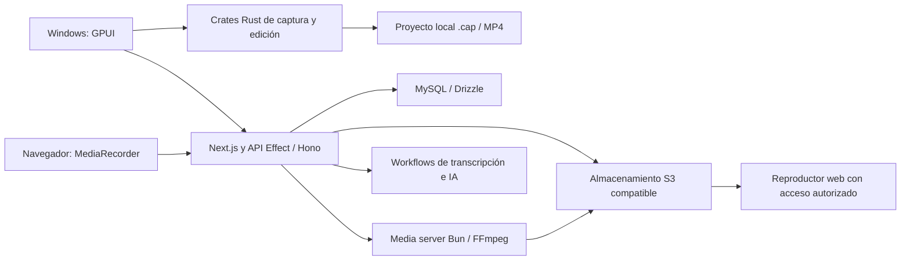

# Screenly — auditoría técnica y arquitectura

Fecha: 26 de octubre de 2026. Base inspeccionada: `84acab6caff0a32b6c1c15ae108d9f8a1a5ea421`.
Rama: `feature/screenly-phase-0`. Alcance: documentación; sin cambios funcionales,
servicios, Docker, migraciones, APIs de pago ni acceso al VPS.

## Resumen ejecutivo

Screenly hereda una plataforma Cap considerablemente desarrollada: cliente nativo
Rust, grabador web, editor, publicación, biblioteca multiusuario, comentarios,
almacenamiento y canalizaciones de IA. Conviene aprovechar esos componentes antes
de reescribirlos. El cliente de escritorio vigente es **GPUI**, no Tauri: lo
corroboran `apps/desktop-gpui/README.md`, su manifiesto y el empaquetado en
`.github/workflows/desktop-release.yml`. Tauri 0.6.0 permanece como harness y
referencia; desde 0.6.1 se empaqueta GPUI con herramientas de Tauri.

No se puede declarar el producto listo para Windows 10/11 o producción privada:
faltan validación física en Windows, pruebas E2E del sistema integrado,
endurecimiento de privacidad, revisión de avisos de dependencias y decisión sobre
AGPL. Hay Whisper local en escritorio; llevar transcripción gratuita al servidor
requiere una integración adicional. El proveedor LLM compatible con OpenAI ya
ofrece una conexión reutilizable hacia modelos autoalojados.

## Cómo interpretar la evidencia

- **P**: comportamiento cubierto por pruebas ejecutadas en esta auditoría, con el
  alcance concreto indicado; no significa validación de hardware o producción.
- **C**: implementación identificada mediante lectura del código y sus llamadas.
- **N**: comportamiento no comprobado o integración pendiente.

La revisión cubre todas las familias del monorepo y traza las rutas críticas.
No es una revisión línea por línea de cada dependencia vendorizada, ni una
certificación de seguridad. El README GPUI contiene secciones históricas y cifras
de rendimiento; no se toman como medidas obtenidas en este entorno.

## Inventario del monorepo

| Ubicación                 | Responsabilidad y estado observable                                                                     | Decisión                                                       |
| ------------------------- | ------------------------------------------------------------------------------------------------------- | -------------------------------------------------------------- |
| `apps/desktop-gpui`       | Cliente de distribución Rust/GPUI, workspace y lockfile propios                                         | Base nativa Screenly                                           |
| `apps/desktop`            | Tauri v2 + SolidStart, última distribución documentada 0.6.0; harness y bindings conservados            | Referencia y compatibilidad; evitar una segunda UI de producto |
| `apps/web`                | Next.js 16.3.0, React 19, dashboard, grabación, API, reproducción y administración                      | Base web y backend de negocio                                  |
| `apps/media-server`       | Bun/Hono; procesamiento con FFmpeg, node-av y Mediabunny                                                | Reutilizar como trabajador multimedia aislado                  |
| `apps/render-farm`        | Coordinador y workers de exportación GPU, HLS y S3; `src/coordinator.ts`, `scheduler.ts`, `recovery.ts` | Opcional; no necesario para el primer producto                 |
| `apps/cli`                | Rust: cuenta, grabación, subida, automatización y API de agentes                                        | Reutilizar diagnósticos y pruebas futuras                      |
| `apps/chrome-extension`   | Extensión Chrome, Vite/React, comparte `recorder-core`                                                  | Opcional; grabación web no debe depender de instalarla         |
| `apps/mobile`             | Expo/React Native, scripts centrados en iOS                                                             | Fuera del objetivo Windows/web                                 |
| `apps/status`             | Next.js, página de estado con Redis                                                                     | Operación opcional                                             |
| `apps/discord-bot`        | Integración Discord y comprobaciones de releases                                                        | Fuera del producto privado inicial                             |
| `apps/src/utils/tauri.ts` | Archivo auxiliar, sin manifiesto de aplicación independiente                                            | No confundir con un cliente activo                             |
| `infra`                   | SST (`sst.config.ts`)                                                                                   | Referencia de infraestructura; sin ejecutar                    |
| `packages/local-docker`   | Servicios de desarrollo MySQL/MinIO                                                                     | Inspeccionado, sin iniciar                                     |
| `vendor`, `capcodec`      | Forks gráficos/ventanas y codec; dependencias nativas especializadas                                    | Mantener hasta validar su necesidad y licencias                |

La presencia de fuentes, tests y CI demuestra mantenimiento en este snapshot;
no establece soporte futuro ni valida cada aplicación secundaria.

## Flujo y límites del sistema actual



- Captura nativa: `apps/desktop-gpui/src/recording.rs::start` →
  `crates/recording` → fuentes de pantalla/cámara/audio → codificadores/muxer.
- Publicación: `apps/desktop-gpui/src/upload.rs::prepare_instant_upload` y
  `upload_exported_video`; web multipart en
  `apps/web/app/api/upload/[...route]/multipart.ts`.
- Backend: `packages/web-domain` define modelos, políticas y contratos Effect;
  `packages/web-backend` implementa repositorios/servicios; `apps/web/lib/server.ts`
  adapta la API a Next.js. Hay también rutas Hono y rutas Next específicas:
  no toda la API usa una única infraestructura.
- Datos: `packages/database/index.ts::db` exige MySQL; Drizzle define usuarios,
  organizaciones, espacios, carpetas, vídeos, comentarios, subidas y trabajos en
  `packages/database/schema.ts`. La biblioteca local no es una réplica automática
  de la biblioteca remota; la unión se hace mediante publicación e identificadores.
- Archivos: `packages/web-backend/src/S3Buckets` y `Storage` separan objetos de
  metadatos. `packages/s3/README.md` describe rutas históricas; los tipos `source`
  en el esquema y los resolutores actuales son la referencia para nuevos vídeos.

## Matriz de capacidades

| Capacidad                            | Estado actual | Evidencia / pendiente                                                       |
| ------------------------------------ | ------------- | --------------------------------------------------------------------------- |
| Pantalla, ventana y región nativas   | C             | `ScreenCaptureTarget`, backend Windows Direct3D; falta ejecución Windows    |
| Selección de monitor                 | C             | Enumeración `list_displays`; mosaico simultáneo de monitores no demostrado  |
| Webcam, micrófono y audio de sistema | C/P parcial   | Dispositivos nativos; mezcla y liberación SDK probadas con mocks            |
| Pausa/reanudación                    | C/P parcial   | Métodos Rust y pruebas de SDK; continuidad audiovisual real N               |
| Grabación web sin extensión          | C/P parcial   | `WebRecorderDialog`, `recorder-core`; permisos reales del navegador N       |
| Recuperación tras interrupción       | C/P parcial   | Recovery nativo y spool IndexedDB; pruebas de lógica compartida aprobadas   |
| Editor, trim, zoom, cursor           | C             | GPUI y crates de proyecto/editor/render; interacción Windows N              |
| Exportación MP4                      | C             | `editor_export.rs::start_export`, `crates/export/src/mp4.rs`; export real N |
| Publicación y subidas multipart      | P parcial     | 38 pruebas de presign, 53 de publicación y 62 de ciclo de almacenamiento    |
| Biblioteca compartida y permisos     | C/P parcial   | Esquema y políticas; autorización y metadatos públicos probados             |
| Reproductor y comentarios            | C             | Componentes de share y backend Comments; E2E N                              |
| Whisper local y subtítulos           | C             | Motor GPUI existente; modelos/inferencia no ejecutados                      |
| Transcripción web automática         | C             | AssemblyAI; integración autoalojada pendiente                               |
| Título, resumen y capítulos          | C/P parcial   | Workflows y selección LLM; pruebas de estructura, sin inferencia            |
| Búsqueda en transcripción            | P parcial     | Sidebar del editor; búsqueda global indexada no establecida                 |
| SRT uniforme en GPUI/web             | N             | Exportador en Tauri histórico; VTT web existente                            |

## Dependencias y reproducción

Node **24** (verificado 24.19.0), Bun **1.4.4** y `bun.lock` para JS.
Workspace Rust principal: **1.88.0**; GPUI: toolchain `stable` propio y
dependencias con mínimo documentado **1.89+**. No fijar 1.88 globalmente para GPUI.
Los forks GPUI/Zed, CPAL y FFmpeg están referenciados por revisión Git.
Consultar ambos `Cargo.lock`; `stable` no fija una versión exacta del compilador.

Windows exige toolchain MSVC/Windows SDK y las herramientas nativas documentadas
en `CONTRIBUTING.md` y `scripts/setup.js` (incluidos LLVM/Clang, VCPKG y CMake según
el camino de compilación). El setup usa FFmpeg 7.1 para Windows. El release añade
sidecars, firma y NSIS. No se compiló Rust ni se firmaron artefactos en este Linux.

`CLOUD_ENVIRONMENT.md` y `scripts/cloud-environment-setup.sh` documentan el entorno
sin servicios. En esta tarea se conservaron manifiestos, lockfiles y versiones.

## Pruebas ejecutadas en esta auditoría

Todos los comandos usan `PATH=/workspace/.tools/node_modules/.bin:$PATH`.

| Directorio / comando                         | Resultado actual                                |
| -------------------------------------------- | ----------------------------------------------- |
| `packages/recorder-core`: `bun run test`     | 7 archivos, 84 aprobadas                        |
| `packages/sdk-recorder`: `bun run test`      | 4 archivos, 35 aprobadas                        |
| `apps/web`: selección Vitest siguiente       | 14 archivos, 278 aprobadas                      |
| `apps/media-server`: selección Bun siguiente | 2 archivos, 29 aprobadas                        |
| Raíz: `bun audit --json`                     | Salida 1; avisos de dependencias, ver seguridad |

Total: **426 pruebas distintas aprobadas**, sin fallidas ni omitidas en esas
selecciones. `recording-preverify` se ejecutó además por separado: 13 aprobadas,
ya incluidas en las 29; no se suman de nuevo. Errores en stderr de casos negativos
son esperados. Tests con mocks no invocan APIs de pago ni abren servicios.

```bash
cd /workspace/Screenly/apps/web
bun run test __tests__/unit/share-cap-authorization.test.ts __tests__/unit/public-share-video.test.ts __tests__/unit/s3-bucket-access.test.ts __tests__/unit/agent-auth.test.ts __tests__/unit/ai-provider.test.ts __tests__/unit/ai-run.test.ts __tests__/unit/summary-chapters.test.ts __tests__/unit/transcript-vtt.test.ts __tests__/unit/transcript-sidebar-search.test.ts __tests__/unit/edit-transcript.test.ts __tests__/unit/live-transcribe-core.test.ts __tests__/unit/multipart-presign.test.ts __tests__/unit/desktop-recording-publication.test.ts __tests__/unit/recording-storage-lifecycle.test.ts
cd /workspace/Screenly/apps/media-server
bun test src/__tests__/lib/media-transfer.test.ts src/__tests__/lib/recording-preverify.test.ts
```

La compilación `web-domain` y tipos de `recorder-core` pasaron en el onboarding
anterior; no se presentan como build completo de esta auditoría. No ejecutados:
E2E, suites Rust, migraciones, integración real S3/MySQL, UI Windows ni benchmarks.

## Arquitectura recomendada

Conservar GPUI y el núcleo Rust para Windows; conservar Next.js y `recorder-core`
para navegador. Ambos publican a una biblioteca remota común con políticas por
organización. Separar trabajo multimedia e IA de las peticiones interactivas;
mantener estados, reintentos e idempotencia en workflows. Usar S3 privado y
acceso autorizado también a derivados. Añadir adaptador de transcripción local
en servidor y configurar un LLM autoalojado sin fallback a proveedores de pago.
Posponer render farm, móvil, agentes e integraciones comerciales hasta cumplir
el flujo privado básico. Detalles y criterios de entrega: `SCREENLY_ROADMAP.md`.
