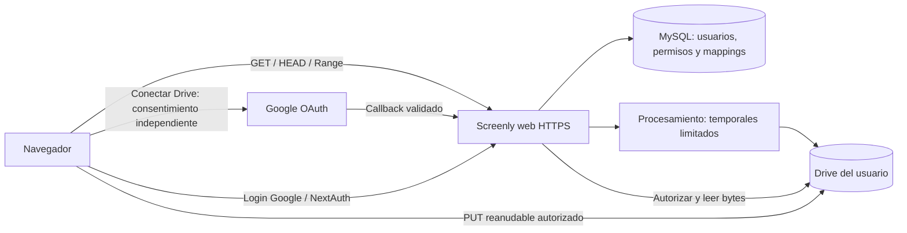

# Screenly: Google Login, Drive personal web y laboratorio Coolify

Fecha: 2026-10-29. Rama `feature/screenly-phase-0`, base `5b106bc97`.
Árbol inicialmente limpio. Entrega: auditoría, propuesta y caracterización
aislada del arranque; **sin cambios productivos ni despliegue**.

## Conclusión y arquitectura propuesta

Google Login y el adaptador Drive ya existen. Se propone reutilizarlos para
MP4 y añadir después una conexión personal desde la web, conservando por separado
la integración de organización. No construir otro proveedor ni presentar
la cuenta de servicio del laboratorio como OAuth para usuarios finales.

Es una propuesta, no un flujo E2E verificado. La subida directa puede evitar
conservar el original permanentemente en el servidor; procesamiento/exportación,
temporales, MySQL y el proxy siguen consumiendo disco o tráfico. Drive tiene
cuotas y las URLs de sesión de subida también son capacidades sensibles.
No prometer cero almacenamiento auxiliar ni Drive-only sin validar dependencias.

## Qué está implementado

| Capacidad                       | Evidencia concreta                                                                                                                                       | Límite                                                                                                  |
| ------------------------------- | -------------------------------------------------------------------------------------------------------------------------------------------------------- | ------------------------------------------------------------------------------------------------------- |
| Google Login web                | `packages/database/auth/auth-options.ts::authOptions`, GoogleProvider; `apps/web/app/(org)/login/form.tsx::handleGoogleSignIn` llama signIn google       | No se ejecutó OAuth real; falta caracterización de configuración parcial/scopes                         |
| Callback de identidad           | `/api/auth/callback/google`, servido por `apps/web/app/api/auth/[...nextauth]/route.ts`                                                                  | Es distinto del consentimiento Drive                                                                    |
| Sesión web                      | strategy jwt y `decodeSessionToken` verifica users.authSessionVersion                                                                                    | Poblar sessions o fabricar cookies no prueba login real; HTTPS para cookies Secure                      |
| OAuth Drive                     | `packages/web-backend/src/Storage/GoogleDrive.ts::getGoogleDriveAuthUrl`                                                                                 | Usa drive.file, offline y consent; no es acceso general a todos los archivos del usuario                |
| Callback Drive                  | `/api/desktop/storage/google-drive/callback` en `api/desktop/[...route]/storage.ts`                                                                      | Reutilizado por flujos personal/organización/desktop; su seguridad necesita cierre antes de ampliar web |
| Almacenamiento personal         | Integración ownerId con organizationId nulo; POST `/api/desktop/storage/google-drive/connect`                                                            | No se encontró UI personal equivalente en ajustes web                                                   |
| Integración web de organización | `actions/organization/storage.ts::connectOrganizationGoogleDrive` y `settings/organization/integrations/storage-integrations.tsx`                        | Conecta almacenamiento del equipo, no el Drive independiente de cada miembro                            |
| Tokens Drive                    | encryptedConfig, access token cifrado y lease de renovación en StorageRepo/GoogleDriveTokenStore                                                         | No confundir con campos text de tokens de identidad en accounts                                         |
| Subida web                      | `actions/video/upload.ts::getVideoUploadPresignedUrl` y createVideoAndGetUploadUrl usan Storage.createUploadTargetForUser y guardan storageIntegrationId | Ya soporta target Drive; no se ha probado CORS ni cuota contra Drive por usuario real                   |
| Grabación multipart             | `packages/recorder-core/src/instant-mp4-uploader.ts` distingue Drive secuencial de S3                                                                    | No sustituir por multipart S3 paralelo                                                                  |
| Lectura                         | Storage.getAccessForVideo y proxies MP4/derivados                                                                                                        | Históricos conservan proveedor; enlaces legacy/HLS no quedan protegidos por esta auditoría              |

Las rutas relativas de código están bajo apps/web, salvo las indicadas como
packages. La documentación de equipo `apps/web/content/docs/teams/google-drive.mdx`
también distingue conexión personal Desktop de configuración organizacional web.

## Hallazgos y orden de corrección

### P0 de despliegue: arranque administrativo automático

`apps/web/instrumentation.ts` llama register de `instrumentation.node.ts`.
En self-hosting programa dos tareas a los cinco segundos:

- runMigrations llama migrateDb si NEXT_PUBLIC_DOCKER_BUILD es true.
- createS3Bucket intenta crear bucket; si lo consigue aplica una política con
  Principal asterisco y s3:GetObject sobre todos los objetos de ese bucket.

El Dockerfile web activa ese modo Docker. Un arranque de laboratorio con el
código actual puede modificar esquema y configurar almacenamiento público.
No se arranca la imagen para probar login ni se usa una bandera de marca como
bypass. Esto describe código y mocks, no una exposición comprobada del VPS.
La rama BucketAlreadyOwnedByYou no aplica esa política; no afirmar que cualquier
bucket existente se vuelve público.

**Primer incremento productivo recomendado, sujeto a aprobación:** separar
migración y preparación de storage en operaciones administrativas explícitas,
desactivadas por defecto; no crear permisos de lectura anónima. La app normal
no debe necesitar administración de buckets ni DDL al arrancar. Diseñar manejo
de esquema/almacenamiento ausentes y readiness sin ocultar errores. Los nombres
de flags, jobs y contratos de configuración se definirán en ese incremento.

### P1 antes de construir la imagen: contexto y procedencia

`apps/web/Dockerfile` hace COPY del contexto completo y `.dockerignore`
no excluye .env ni .git. Un archivo sensible presente podría incorporarse al
contexto/capas de construcción; no se inspeccionaron .env privados ni se creó
una imagen para comprobar filtración. Preparar exclusiones y pruebas antes de
builds con secretos; no pasar credenciales por ARG ni incluirlas en la imagen.

`docker-compose.coolify.yml` usa imágenes Cap upstream latest, que no garantizan
incluir los commits Screenly. El laboratorio deberá construir/publicar una
imagen propia identificada por commit y digest, con autorización separada.
Un build exitoso no reemplaza typecheck: next.config.mjs ignora errores TS al
construir. No se ejecuta el workflow test-self-hosting: arranca compose y espera
tablas migradas.

### P1 antes de exponer conexión personal: vinculación OAuth

createGoogleDriveState/verifyGoogleDriveState en storage.ts y la acción
organizacional firman usuario, scope y caducidad; no hay nonce consumible,
persistencia de uso único ni vínculo de navegador/sesión comprobado en el callback.
El callback público recupera al propietario del payload firmado. No afirmar
explotación E2E: se identificó la frontera por inspección de código.

Preparar pruebas de state alterado, caducado, reutilizado y de un flujo iniciado
por A que se abre en el navegador de B. Diseñar vínculo al iniciador y consumo
único preservando Desktop/CLI: exigir sesión de navegador indiscriminadamente
puede romperlos. La sesión Screenly autorizada y la cuenta Google elegida para
Drive son identidades distintas; decidir si se permite conectar otra cuenta,
sin usar igualdad de emails como sustituto de autorización.

La acción de organización acepta settings manager, pero el callback vuelve a
exigir owner: un administrador puede iniciar el flujo y ser rechazado al volver.
Alinear esa política como cambio separado, sin ampliar permisos silenciosamente.

### P1 de producto: destino de nuevas grabaciones y desconexión

Storage.getWritableAccessForUser prioriza organización, luego Drive personal
activo y finalmente S3. Clientes Desktop antiguos pueden seleccionar S3 personal;
una organización Drive con cliente incompatible recibe 426. Conectar un Drive
personal no garantiza que sea el destino efectivo de toda grabación.

Para el objetivo Screenly, proponer elección explícita del destino y fallar
cerrado si el Drive elegido no está disponible, sin fallback S3 inadvertido.
Es una decisión pendiente; no se modifican políticas existentes en esta entrega.

Desconectar actualmente desactiva nuevas selecciones y limpia el access-cache,
pero conserva refreshConfig cifrado y no revoca Google. getDriveAccess por ID
puede seguir leyendo vídeos históricos. La UI futura debe distinguir dejar de
usar para nuevas grabaciones de revocar el proveedor. Definir qué ocurre con
vídeos compartidos antes de introducir revocación o borrado de tokens.

### P2 de login: configuración, scopes y vinculación de cuentas

GoogleProvider se registra aunque falten ID/secret; googleAuthAvailable en
AppProviders y móvil solo comprueba client ID. Preparar matriz ausente/parcial/
completa para provider y consumidores. El scope configurado contiene dos URI
userinfo pero omite openid, mientras el proveedor instalado usa discovery y
idToken; verificar compatibilidad sin afirmar un fallo Google observado.

No habilitar allowDangerousEmailAccountLinking para resolver coincidencias con
cuentas OTP. Revisar claims/email verificado y las reglas de vinculación antes
de basar grants en email. accounts persiste tokens de identidad en text; no
reutilizar esa tabla como bóveda de Drive ni afirmar cifrado de todos los tokens.

## Propuesta Coolify concreta para revisar

Reutilizar el plan de VM dedicada fuera de producción de
[SCREENLY_LAB_EXECUTION_PROPOSAL.md](SCREENLY_LAB_EXECUTION_PROPOSAL.md), con
Coolify como gestor de una instancia de laboratorio, no como razón para usar el
VPS productivo sin evaluación. No se ha instalado Coolify ni accedido a uno real.

| Servicio         | Propuesta y condición previa                                                                                                              |
| ---------------- | ----------------------------------------------------------------------------------------------------------------------------------------- |
| Web              | Imagen propia al commit aprobado; HTTPS externo, runtime no-root, puerto interno 3000; arranque administrativo corregido                  |
| MySQL            | Privado, esquema preparado por operador autorizado, backups cifrados y roles separados; sin publicar 3306                                 |
| Media server     | Privado, puerto 3456; límites de CPU/RAM/temporales y drenaje; token webhook compartido con web                                           |
| Storage auxiliar | Mantener necesidad declarada hasta auditar usos S3; privado, sin política anónima. No prometer retirarlo por conectar Drive               |
| Red y callbacks  | WEB_URL y NEXTAUTH_URL coherentes con origen HTTPS; web a media por MEDIA_SERVER_URL y retorno MEDIA_SERVER_WEBHOOK_URL                   |
| Persistencia     | MySQL y posibles objetos auxiliares permanentes; temporales acotados con limpieza, sin volúmenes de producción                            |
| Observabilidad   | Health web en / y media en /health son comprobaciones parciales; media puede devolver 200 degraded. Verificar readiness real por separado |

El compose actual declara MySQL 8.0; la propuesta de laboratorio recomienda
evaluar 8.4 LTS con gate de compatibilidad, no sustituirla sin prueba. Las versiones,
digests, red, dominio, capacidad y costes siguen pendientes de aprobación.

CAP_AWS_BUCKET y CAP_AWS_REGION siguen siendo requisitos de packages/env/server.ts;
el compose depende de MinIO. Drive-only sin S3 no es un modo de despliegue
demostrado. Reducir almacenamiento permanente no significa quitar a ciegas
esas dependencias.

## Preparación Google Cloud y secretos, sin configurarlos todavía

Cuando exista un origen de laboratorio aprobado, crear/configurar el cliente
OAuth Web y consentimiento con los callbacks actuales:

- https://ORIGEN-APROBADO/api/auth/callback/google
- https://ORIGEN-APROBADO/api/desktop/storage/google-drive/callback

Son plantillas: sustituir ORIGEN-APROBADO; no registrar localhost o un dominio
inventado como destino real. El código usa GOOGLE_CLIENT_ID/GOOGLE_CLIENT_SECRET
para ambos flujos. Login no concede Drive; drive.file exige consentimiento
independiente y acceso a archivos creados/abiertos por la aplicación, no a
cualquier carpeta compartida con la cuenta de servicio del laboratorio.

Confirmar APIs habilitadas, modo de consentimiento/usuarios de prueba, políticas
Google y acceso a carpeta antes de pruebas reales. La UI organizacional usa
NEXT_PUBLIC_GOOGLE_PICKER_API_KEY; decidir su uso en personal y restringir la
clave pública por origen/API, sin exponer el client secret. No crear cuentas ni
activar APIs desde esta tarea.

Conservar por separado NEXTAUTH_SECRET, DATABASE_ENCRYPTION_KEY y secreto de
webhook, entregados por mecanismo seguro de Coolify. Mantener la clave de cifrado
en restauraciones; cambiarla sin plan puede hacer ilegibles las integraciones.
Revisar valores build-time frente a runtime. NEXT_PUBLIC_IS_CAP es string:
el valor textual false es truthy en varios guards. No usarlo para eludir controles
ni suponer que cambiar una variable runtime corrige un bundle ya construido.

El ejemplo docker-compose.coolify.env.example no cubre exactamente todas las
interpolaciones SERVICE_PASSWORD y SERVICE_HEX del compose. Inventariar contratos
reales de Coolify antes de producir un archivo desplegable; no publicar secretos.

## Pruebas de esta entrega y límites

Se añade únicamente
`apps/web/__tests__/unit/self-hosted-bootstrap-characterization.test.ts`:
cinco casos con SDK S3, migrador y entorno simulados, timers falsos y process.exit
interceptado. Demuestran el comportamiento actual de arranque, incluyendo bucket
nuevo público, non-Docker, guard textual false, bucket existente y entorno inválido.
**Son caracterización del problema, no garantías seguras ni una corrección.**
Al aprobar el cambio deberán reemplazarse por expectativas seguras.

Se ejecutaron cinco suites existentes: auth-options, nextauth-email-route,
google-drive-storage, recording-storage-lifecycle y storage-object-verification:
**225/225 aprobadas**, con repositorios/transporte simulados. El test nuevo
tiene **5/5 aprobados**: **230 casos aprobados en seis archivos, ejecutados en
dos comandos separados**. Typecheck web terminó con salida 0, cero errores,
56 avisos y 118 sugerencias Effect, mismos conteos que el incremento anterior.
Biome del test, Prettier del documento y git diff se comprueban antes de publicar.
El auditor independiente revisó el aislamiento y la fidelidad de los cinco casos
nuevos y el documento integrado, sin hallazgos bloqueantes. No ejecutó pruebas
adicionales ni conexiones; la revisión no sustituye OAuth o almacenamiento reales.

No se probaron Google OAuth real, consentimientos, callbacks desde Google,
subidas/descargas de usuario, MySQL, Coolify, Docker, CORS, cuota real, E2E,
revocación del proveedor ni almacenamiento real nuevo. Las nueve pruebas Drive
previas conservan su alcance limitado de dos muestras; no se repiten aquí.
Los claims de compatibilidad son inspección o simulación, no certificación.

## Incrementos propuestos y punto de parada

1. Aprobar corrección del arranque self-hosting y contexto de build; pruebas
   seguras por defecto y ninguna migración/política pública implícita.
2. Caracterizar y aprobar vinculación/uso único de OAuth Drive por flujo,
   configuración Google incompleta y contrato de desconexión/destino.
3. Añadir pantalla personal web reutilizando el backend, con errores de cuota/
   permisos y elección explícita del destino; sin ampliar el scope innecesariamente.
4. Preparar imágenes/configuración de laboratorio revisables; solo después
   aprobar despliegue aislado y Google OAuth real, seguido de E2E MP4/derivados.
5. Mantener publicación/proxy HLS como trabajo separado, sin servir firmas como
   fallback ni considerar seguras las rutas legacy por estas pruebas.

Se publican test y documento en commits separados. PR #1 en borrador, main
intacta, sin VPS, servicios, migraciones, esquemas, dependencias, lockfiles o
funcionalidades modificadas. Se detiene tras esta auditoría para revisar el
primer incremento correctivo; no se despliega ni se ejecuta ese cambio.
